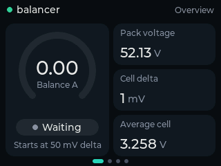
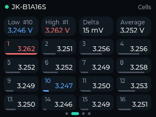
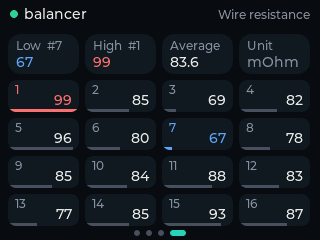
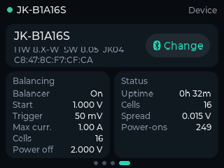
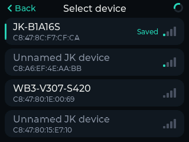

# CYD-JK-BMS-Display-BLE

A wireless display for a [JK BMS](https://www.jkbms.com/) or JK active balancer, built on the
[Cheap Yellow Display](https://github.com/witnessmenow/ESP32-Cheap-Yellow-Display) (ESP32-2432S028R).
It connects over Bluetooth LE and shows what the JK phone app shows, without the phone.

Written in C++ on **ESP-IDF** with a pure **LVGL 9** UI. No Arduino, TFT_eSPI or touchscreen libraries:
the ILI9341 runs through ESP-IDF's `esp_lcd`, the XPT2046 touch controller is read directly, and Bluetooth
uses ESP-IDF's NimBLE.

Originally based on [peff74/Arduino-jk-bms](https://github.com/peff74/Arduino-jk-bms).

| Overview | Cells |
|---|---|
|  |  |
| **Wire resistance** | **Device** |
|  |  |
| **Device picker** | |
|  | |

*A JK-B1A16S balancer, 16 cells. Captured with the `shot` console command.*

## Features

- **Pick the device on screen.** On first boot the CYD scans and lists the JK devices nearby with their
  signal strength. Tap one to save and connect; it reconnects on every boot. No MAC addresses in the code.
- **Swipe between pages** (dots at the bottom show where you are):
  - **Overview**
    - BMS: state-of-charge ring, Charging / Discharging / Idle, Ah left, voltage, current, power
    - Balancer: balance current ring (against the max balance current), Balancing / Waiting / Off,
      trigger delta, pack voltage, cell delta, average cell voltage
  - **Cells**: lowest / highest cell, delta and average on top, a tile per cell below with a level bar.
    The lowest cell is blue, the highest red. The grid sizes itself to the cell count (up to 32).
  - **Wire resistance**: the balance lead resistance of each cell in milliohms, highest in red.
  - **Device**: model, hardware / software version, protocol, the balancing settings, uptime
    (plus temperatures, cycles and switches on a BMS), and a **Change** button to pick another device.
- **Status bar** with the device name and a connection dot (green: data, amber: connecting).
  Hold it to open the device picker.
- **JK BMS and JK active balancers.** The frame layout is detected automatically:
  - `JK02_32S`: newer BMS (hardware >= 11), e.g. JK-B1A8S10P, JK-PB series
  - `JK02_24S`: older BMS (hardware < 11) and JK02 balancers
  - `JK04`: older balancers, e.g. JK-B1A16S (hw 8.x). Cell voltages, wire resistances, balance current
    and state, and the balancing settings are decoded (verified against the JK app).
- **Serial console** (115200 baud) for debugging without touching the screen.

A JK device takes one connection at a time and doesn't advertise while the JK app is connected to it,
so close the app first.

## Building

Install [PlatformIO](https://platformio.org/) (the VS Code extension or the CLI), then:

```bash
pio run -e cyd -t upload --upload-port COM42   # your port here
pio device monitor -b 115200
```

The first build downloads ESP-IDF, LVGL and the ILI9341 driver (ESP-IDF component manager), so it takes
a few minutes.

Some CYDs don't enter the bootloader on their own. If the upload fails with *Wrong boot mode*, hold
**BOOT**, tap **RST**, release **BOOT** and upload again.

**ESP-IDF version:** the project is pinned to `espressif32@6.9.0` (ESP-IDF 5.3.1). With ESP-IDF 5.5.3
every BLE connection on the ESP32 dropped with a supervision timeout about 4 seconds after connecting.
Re-test a live connection before moving to a newer platform. After changing it, delete
`managed_components/` and `sdkconfig.cyd*`.

Other build environments:

- `cyd_nodisplay`: Bluetooth and console only, display and backlight off (for radio debugging)

### Screen orientation, other panels

The board's pins and display settings are in `src/board/board.h`. Set `LCD_MIRROR_X` and `LCD_MIRROR_Y`
both to `true` to turn the picture by 180 degrees. Some newer CYDs have an ST7789 panel that needs
`LCD_INVERT true`. If touches land mirrored, swap the matching pair of `TOUCH_RAW_*` limits.

## Serial console

| Command | |
|---|---|
| `status` | Device, link state, protocol, every cell, settings |
| `scan` | Open the device picker and scan |
| `found` | JK devices seen by the scan |
| `select <n>` / `select <mac>` | Save and connect to a device (index from `found`, or its MAC) |
| `cancel` | Leave the picker |
| `forget` | Forget the saved device |
| `dump` | Raw device info, settings and cell info frames in hex (for decoding new devices) |
| `page <n>` | Show page 0-3 |
| `shot [name]` | Print the screen over serial; `tools/shots.py <log> <dir>` turns it into a PNG |

## Code layout

| Path | |
|---|---|
| `src/board/board.h` | CYD pins, display and touch settings |
| `src/display/` | ILI9341 over `esp_lcd`, XPT2046 touch, LVGL task and lock |
| `src/jk/jk_proto.*` | JK frame assembly, checksum, layout detection and decoding (no BLE code) |
| `src/ble/jk_ble.*` | NimBLE central: scan, connect, FFE0/FFE1 discovery, reconnect |
| `src/bms/bms_data.*` | Latest decoded state, shared between the BLE and UI tasks |
| `src/ui/` | Pages, device picker, status bar |
| `src/console/` | Serial commands |
| `src/prefs/` | Saved device in NVS |

JK devices are recognised in the scan by their manufacturer data (it ends with the device's own MAC
address), a name starting with `JK`, or the `FFE0` service.

## Ideas

- Screen dimming with the onboard light sensor, screen timeout
- Voltage based SOC as a cross-check of the BMS's own
- Changing settings from the display

## Help

If you have any questions or simply want to share how you've used this repo, please head over to
[Discussions](https://github.com/Giddy-Up224/CYD-JK-BMS-Display-BLE/discussions/1) where you can introduce
yourself and post your project in the
[show and tell](https://github.com/Giddy-Up224/CYD-JK-BMS-Display-BLE/discussions/categories/show-and-tell)
channel.

## Credits

Thanks to [@peff74](https://github.com/peff74/), FINALLY a solution that actually has the backend working
out of the box!
